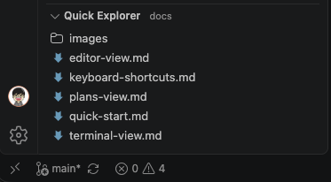

# Quick Explorer

[](https://github.com/NaokiIshimura/vscode-quick-explorer/releases) [](https://code.visualstudio.com/) [](https://opensource.org/licenses/ISC)

VSCodeのサイドバーに、設定したディレクトリのエクスプローラーを常に開いておくことができる拡張機能です。

[English](README.md) | 日本語



## 機能

- **素早いディレクトリナビゲーション**: フォルダをクリックして移動し、".."で上の階層に戻り、ファイルをすぐに開けます。分かりやすいアイコンで表示され、プロジェクトルートからの相対パスで現在位置を確認できます。
- **柔軟なソートオプション**: 4種類のソート順（フォルダ優先 + 名前/変更日時、昇順/降順）を切り替えられます。設定は自動的に保存され、VSCodeを再起動しても復元されます。
- **プロジェクトルートの保護**: プロジェクト内を安全にナビゲートできます。誤ってプロジェクトルートより上に移動することはありません。
- **VSCodeとのシームレスな統合**: Explorerサイドバーにネイティブな「Quick Explorer」パネルを追加します。ギアアイコンから拡張機能の設定に素早くアクセスできます。

## インストール

### VSIXファイルから

1. [Releases](https://github.com/NaokiIshimura/vscode-quick-explorer/releases)ページから最新の`.vsix`ファイルをダウンロード
2. VSCodeを開く
3. 拡張機能ビューを開く（Ctrl+Shift+X / Cmd+Shift+X）
4. 「...」メニューをクリックし、「VSIXからのインストール...」を選択
5. ダウンロードした`.vsix`ファイルを選択

### ソースから

1. リポジトリをクローン:
   ```bash
   git clone https://github.com/NaokiIshimura/vscode-quick-explorer.git
   cd vscode-quick-explorer
   ```

2. 依存関係をインストール:
   ```bash
   npm install
   ```

3. 拡張機能をコンパイル:
   ```bash
   npm run compile
   ```

4. F5キーを押すと、拡張機能が読み込まれた新しいVSCodeウィンドウが開きます

## 使い方

1. VSCodeのExplorerサイドバーを開く
2. 「Quick Explorer」パネルを探す
3. フォルダをクリックしてフォルダ内に移動
4. ".."をクリックして親ディレクトリに移動
5. ファイルをクリックしてエディタで開く
6. ビューヘッダーのソートアイコンをクリックしてソート順を切り替え:
   - フォルダ優先 + 名前順（A-Z）
   - フォルダ優先 + 名前順（Z-A）
   - フォルダ優先 + 変更日時順（古い順）
   - フォルダ優先 + 変更日時順（新しい順）
7. ビューのタイトルにはプロジェクトルートからの相対パスで現在位置が表示されます

## 設定

この拡張機能では以下の設定項目を提供しています:

- **`quickExplorer.defaultPath`**: 起動時に開くデフォルトのディレクトリ
  - 型: `string`
  - デフォルト: `""`（ワークスペースルートまたはホームディレクトリを使用）
  - 説明: 絶対パス、またはワークスペースルートからの相対パスを指定します。空の場合は、ワークスペースルートまたはホームディレクトリが使用されます。

- **`quickExplorer.defaultSortOrder`**: ファイルとフォルダのデフォルトのソート順
  - 型: `string`（enum）
  - 選択肢: `folderFirstNameAsc`, `folderFirstNameDesc`, `folderFirstModifiedAsc`, `folderFirstModifiedDesc`
  - デフォルト: `folderFirstNameAsc`
  - 説明: エクスプローラーでのファイルとフォルダの並び順を決定します。ソートアイコンでソート順を切り替えると、この設定は自動的に更新されます。

設定を変更するには:
1. Quick Explorerビューヘッダーのギアアイコンをクリックする、または
2. ファイル > ユーザー設定 > 設定 を開き、「Quick Explorer」で検索する

## 動作要件

- VSCode 1.105.0 以上

## 開発

### プロジェクト構成

```
vscode-quick-explorer/
├── src/
│   ├── extension.ts                 # 拡張機能のエントリーポイント
│   ├── quickExplorerViewProvider.ts # TreeDataProviderの実装
│   ├── quickExplorerTreeItem.ts     # TreeItemの実装
│   ├── fileSystemService.ts         # ファイルシステム操作
│   ├── types.ts                     # 型定義とヘルパー関数
│   └── test/                        # テストファイル
│       ├── __mocks__/               # VSCode APIのモック
│       └── *.test.ts                # ユニットテスト
├── out/                              # コンパイル済みJavaScriptファイル
├── package.json                      # 拡張機能のマニフェスト
└── tsconfig.json                    # TypeScript設定
```

### ビルドコマンド

- `npm run compile` - TypeScriptをJavaScriptにコンパイル
- `npm run watch` - 開発用のウォッチモード
- `npm run lint` - ESLintを実行
- `npm test` - テストを実行
- `npm run test:watch` - ウォッチモードでテストを実行
- `npm run test:coverage` - カバレッジレポート付きでテストを実行

### VSIXのビルド

`.vsix`パッケージを作成するには:

```bash
npx vsce package
```

## ライセンス

ISC

## リポジトリ

https://github.com/NaokiIshimura/vscode-quick-explorer
